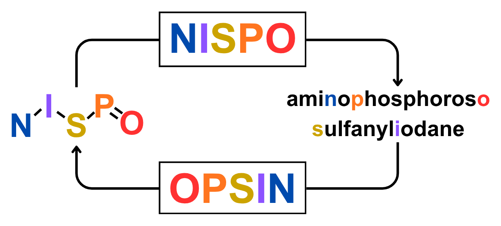

# NISPO

NISPO is an open-source, RDKit-based Python package for generating IUPAC names
of molecules. Generated names are designed to pass an OPSIN round-trip test, in
which [OPSIN](https://doi.org/10.1021/ci100384d) parses the name back to the same
molecular structure. The entire NISPO codebase was generated by OpenAI Codex
using GPT-5.5.

<p align="center">
  
</p>

## Installation

```bash
pip install nispo
```

NISPO requires Python 3.10 or newer.

## Quick start

Use `mol_to_iupac` to name an RDKit molecule, `smiles_to_iupac` to convert a
single SMILES string, or `smiles_to_iupac_batch` to convert multiple SMILES
strings at once:

```python
from rdkit import Chem
from nispo import mol_to_iupac, smiles_to_iupac, smiles_to_iupac_batch

mol = Chem.MolFromSmiles("CCO")
mol_to_iupac(mol)
# 'ethanol'

smiles_to_iupac("CCO")
# 'ethanol'

smiles_to_iupac_batch(["CCO", "not-a-smiles"])
# ['ethanol', '']
```

Unsuccessful conversions return an empty string (`""`). Batch conversion
preserves the number and order of the inputs.

## Performance

NISPO achieved 98.1% OPSIN round-trip accuracy on a held-out benchmark of 103
million PubChem compounds. It is optimized for OPSIN round-trip validity rather
than preferred IUPAC nomenclature, so generated names may differ from names
listed in databases.

## Citation

If you use NISPO in your work, please cite:

```bibtex
@article{runcie2026nispo,
  title   = {{NISPO}: Open-source {IUPAC} name generation tool},
  author  = {Runcie, Nicholas T. and Imrie, Fergus and Deane, Charlotte M.},
  journal = {arXiv preprint arXiv:2607.26113},
  year    = {2026},
  doi     = {10.48550/arXiv.2607.26113}
}
```

OPSIN is described in Lowe, D. M.; Corbett, P. T.; Murray-Rust, P.; Glen, R. C.
*Chemical Name to Structure: OPSIN, an Open Source Solution.* **Journal of
Chemical Information and Modeling** 2011, 51 (3), 739–753.
[https://doi.org/10.1021/ci100384d](https://doi.org/10.1021/ci100384d).

## License

NISPO is released under the BSD 3-Clause License. See [LICENSE](LICENSE).

## AI disclosure

This repository was developed using OpenAI Codex. The codebase is AI-generated
and was created through an autonomous self-iteration process: Codex repeatedly
ran the benchmark, inspected failures, updated the implementation, and reran
the benchmark until high OPSIN round-trip accuracy was achieved.
